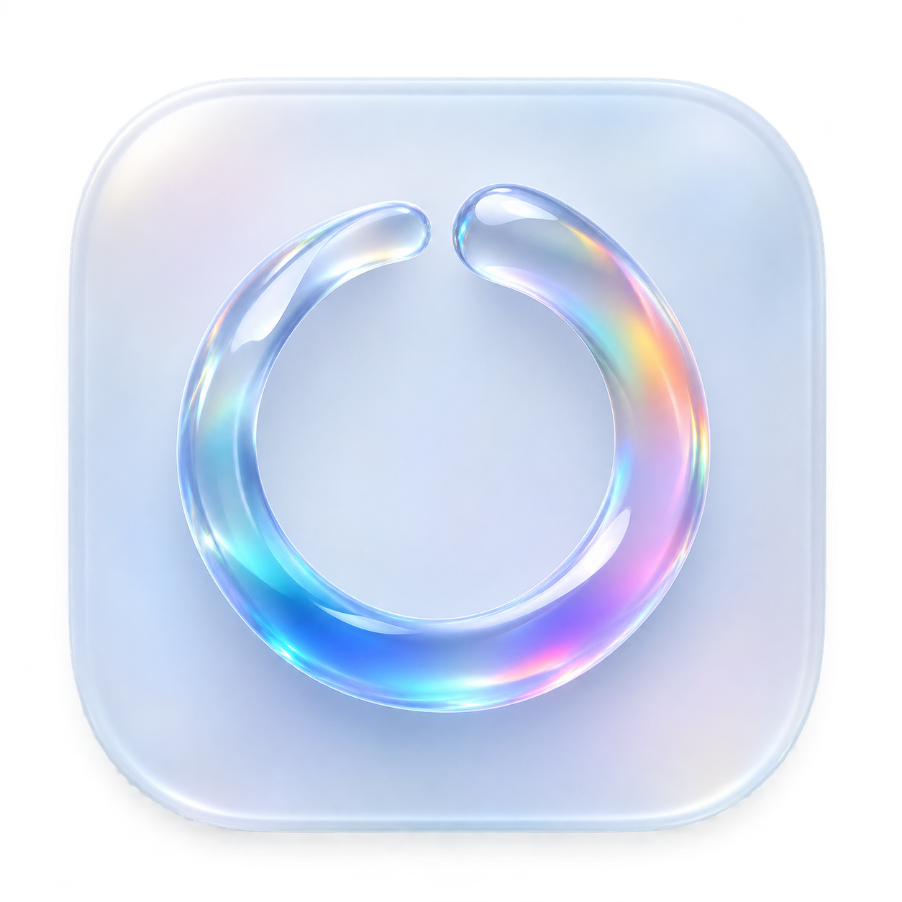
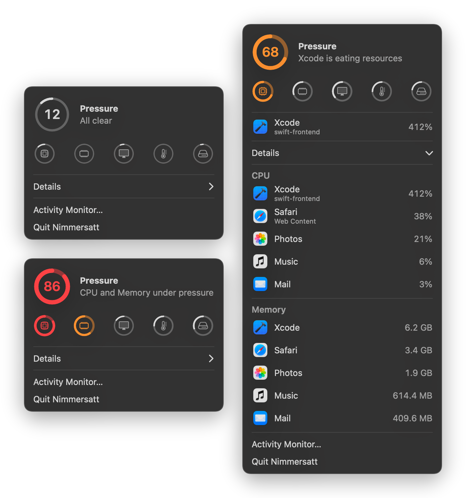

<p align="center">
  
</p>

<h1 align="center">nimmersatt</h1>

<p align="center">one ring in the menu bar: how much pressure your mac is under, and which app is causing it.</p>

<p align="center">
  
</p>

## what it does

- **one number**, pressure 0 to 100. the ring stays faint while calm, turns orange above 50 and red above 75.
- **five contributors**: cpu, memory, gpu, thermal, disk. the weakest sets the score, and every further strained one compounds it.
- **names the culprit**: any app holding a full core, half the gpu or 50MB/s of disk, plus the 3 biggest apps when memory is tight.
- **details**: top 5 apps by cpu and by memory, helpers grouped under the app you launched, like activity monitor.
- **cheap**: 0.2-0.8% cpu while idle, samples every 2s, no privileges needed.

## install

requires macos 14 or later.

download `Nimmersatt-<version>.zip` from [releases](https://github.com/noxan/nimmersatt/releases), unzip and open `Nimmersatt.app`. the build is ad-hoc signed, so the first launch needs right-click, open.

or build from source:

```sh
make app && open Nimmersatt.app
```

## develop

```sh
make check        # self-check: sampling, grouping, scoring
make screenshot   # re-render the screenshot above from mocked data
make release      # semver bump, changelog, tag, github release
```

thresholds live in `Tuning` in `Sources/Nimmersatt/Score.swift`.
